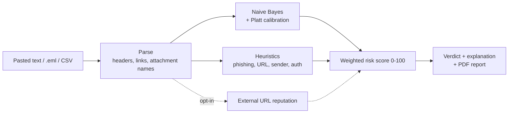

<p align="center">
  
</p>

<p align="center">
  <b>An explainable email security and phishing-indicator platform built on a Multinomial Naive Bayes spam classifier.</b>
</p>

<p align="center">
  
  
  
  
  
</p>

<p align="center">
  <a href="https://mail-guard-spam-filter-ai.streamlit.app/"><b>Live demo (v1 classifier)</b></a> ·
  <a href="https://github.com/rati-ranjan-04/mail-guard-ai"><b>Source code</b></a>
</p>

---

## Table of contents

- [Highlights](#highlights)
- [What it does](#what-it-does)
- [How a scan works](#how-a-scan-works)
- [Dashboard pages](#dashboard-pages)
- [Model results](#model-results-reproducible)
- [Risk score](#risk-score)
- [Security design](#security-design)
- [Installation and running](#installation-and-running)
- [Reproducibility and versioning](#reproducibility-and-versioning)
- [Project structure](#project-structure)
- [Limitations](#limitations)
- [License](#license)

## Highlights

- **Explainable by design.** Every prediction shows the exact per-term contribution to the Naive Bayes log-odds, plus rule-by-rule findings.
- **Calibrated probabilities.** Platt scaling on out-of-fold log-odds (Brier score 0.0085 → 0.0079, expected calibration error 0.0108 → 0.0058).
- **Offline by default.** URL, sender, header and phishing-language checks need no network. Links are never fetched, resolved or opened.
- **Auditable 0–100 risk score** with a visible breakdown of every component.
- **Honest about its limits.** Only the spam classifier is a trained and measured model; everything else is clearly labelled as heuristic.

## What it does

| Capability | Status | How |
| --- | --- | --- |
| Spam vs legitimate classification | **Implemented (ML)** | Multinomial Naive Bayes on TF-IDF (word 1-2 grams); the original trained pipeline is preserved |
| Calibrated probability | **Implemented** | Platt scaling on out-of-fold NB log-odds (`models/calibration.json`) |
| Explainable predictions | **Implemented** | Exact per-term decomposition of the NB log-odds + rule-by-rule findings |
| URL extraction and analysis | **Implemented (heuristics, offline)** | IP hosts, `@` tricks, punycode, shorteners, abused TLDs, brand look-alikes, href/text mismatch, risky file types |
| Sender / domain risk indicators | **Implemented (heuristics, offline)** | Display-name spoofing, look-alike domains, Reply-To / Return-Path mismatch, free-mail "official" senders |
| SPF / DKIM / DMARC | **Implemented as header *parsing*** | Reads results recorded by the receiving server (top-most `Authentication-Results`); no DNS or cryptographic verification |
| Phishing language and attachment names | **Implemented (heuristics)** | Credential requests, threats, urgency, OTP requests, executables, double extensions |
| Risk score 0-100 + severity | **Implemented** | Documented weighted sum with visible breakdown (Low 0-24, Medium 25-49, High 50-74, Critical 75-100) |
| URL reputation (Google Safe Browsing, VirusTotal) | **Optional, external** | Needs API keys and per-scan opt-in; only the URL string is sent; mocked tests only (not live-verified here) |
| Batch CSV, history, PDF reports, dark/light UI | **Implemented** | See [Dashboard pages](#dashboard-pages) |
| Trained phishing model | **Not implemented** | The dataset has no phishing labels, so phishing indicators are heuristics and have **not** been benchmarked |
| URL fetching / sandboxing, attachment malware scanning, WHOIS / IP reputation, live DNS checks | **Not implemented** | Out of scope; nothing is ever opened or executed |

> **Honesty note.** Only the spam classifier is a trained and measured model. The 0-100 risk score weights are hand-set design choices, not learned values, and the phishing/URL/sender/header modules have not been evaluated on labelled phishing data. A low score never guarantees a message is safe.

## How a scan works



## Dashboard pages

Overview · Email scanner · URL scanner · Batch analysis (CSV) · Scan history · Analytics & model · Capabilities & limits.

Light and dark themes follow the Streamlit theme setting (menu at top right → Settings → Theme). Every page has loading, success, warning and error states.

<!-- Add screenshots here, for example:

-->

## Model results (reproducible)

All numbers are produced by `python src/train_compare.py` and stored in `reports/evaluation.json`; the dashboard reads that file.

**Original split reproduced exactly** (shipped model, 1,139 test rows): accuracy 98.95 %, precision 98.16 %, recall 97.45 %, F1 97.80 %, ROC-AUC 99.93 %: identical to the v1 README.

**Leak-free test set** (53 test rows that also occur in the training set after cleaning were removed, leaving 1,086 rows, 25.2 % spam):

| Model | Accuracy | Precision | Recall | F1 | ROC-AUC | PR-AUC |
| --- | ---: | ---: | ---: | ---: | ---: | ---: |
| **Multinomial Naive Bayes (primary)** | 0.9908 | 0.9889 | 0.9745 | 0.9816 | 0.9994 | 0.9983 |
| Logistic Regression | 0.9917 | 0.9853 | 0.9818 | 0.9835 | 0.9997 | 0.9991 |
| Linear SVM | 0.9917 | 0.9853 | 0.9818 | 0.9835 | 0.9995 | 0.9985 |
| Complement Naive Bayes | 0.9853 | 0.9510 | 0.9927 | 0.9714 | 0.9994 | 0.9983 |
| Baseline: stratified random | 0.6390 | 0.2765 | 0.2664 | 0.2714 | 0.5156 | 0.2588 |
| Baseline: always ham | 0.7477 | 0.0000 | 0.0000 | 0.0000 | 0.5000 | 0.2523 |

Logistic Regression is marginally ahead of Naive Bayes on this split, but the bootstrap 95 % confidence intervals of F1 overlap (NB 0.970-0.992, LR 0.972-0.993), so the difference is not meaningful with about 1,000 test messages. Naive Bayes remains the primary model because it is fast, tiny and exactly explainable.

The dashboard also shows confusion matrices, ROC and Precision-Recall curves, a threshold table, and the false-positive / false-negative messages (5 and 5 for the calibrated primary model).

> These results are specific to one public spam/ham corpus and split. They do not predict performance on modern, targeted or non-English email, and say nothing about phishing detection accuracy.

## Risk score

```text
risk = min(100, ML + phishing + URL + sender + auth + external)
```

| Component | Max points | Notes |
| --- | ---: | --- |
| ML | 40 | 40 × calibrated spam probability |
| Phishing language | 25 | Heuristic; earns its maximum at a sub-score of 60 |
| URL | 20 | Heuristic; earns its maximum at a sub-score of 60 |
| Sender | 10 | Heuristic; earns its maximum at a sub-score of 60 |
| Authentication | 10 | Heuristic; earns its maximum at a sub-score of 60 |
| External reputation | 30 | Optional, opt-in per scan |

Components that cannot be assessed (for example sender/auth when only a pasted body is supplied) add **0 points and are not treated as failures**.

**Severity:** Low 0-24 · Medium 25-49 · High 50-74 · Critical 75-100.

**Verdict:** *Likely phishing* when score ≥ 50 and strong phishing/URL/authentication signals exist; otherwise *Spam* (probability ≥ 0.5), *Suspicious* (score ≥ 25) or *Legitimate (low risk)*.

## Security design

- **Safe handling.** Links are parsed as text only: **never fetched, resolved or opened**; shown defanged (`hxxp://example[.]com`). Attachments are described by name/type/size and **never saved or executed**.
- **Input validation.** Pasted text ≤ 200 k characters; CSV ≤ 5 MB / 2,000 rows; `.eml` ≤ 2 MB; binary content rejected; extension checks; CSV exports neutralise spreadsheet-formula injection.
- **Output escaping.** All dynamic values in HTML are escaped; PDF text is escaped and restricted to Latin-1.
- **Privacy-safe logging.** Logs never contain email content: scans log verdict, score and counts; a logging filter additionally masks e-mail addresses, URLs and `key=value` credentials.
- **Minimal history.** Scan history stores only a SHA-256 of the content, length, verdict, scores, sender domain and generic indicator labels, never subjects, bodies or URL paths. It can be cleared in the UI.
- **Model integrity.** SHA-256 of the pipeline is checked against `models/manifest.json`; set `STRICT_MODEL_INTEGRITY=1` to refuse mismatches. `joblib` files are pickles, so only load models you trained yourself.
- **Secrets.** API keys are read only from environment variables / a git-ignored `.env`, never logged, displayed or stored. Streamlit XSRF and CORS protection stay enabled.

## Installation and running

Requires Python 3.10+ (developed and tested on Python 3.13 with scikit-learn 1.8.0). Memory use is small (a few hundred MB); it runs comfortably on an 8 GB laptop.

```bash
git clone https://github.com/rati-ranjan-04/mail-guard-ai.git
cd mail-guard-ai

python3 -m venv .venv
source .venv/bin/activate            # Windows PowerShell: .\.venv\Scripts\Activate.ps1

python -m pip install --upgrade pip
pip install -r requirements.txt

python -m streamlit run app.py       # opens http://localhost:8501
```

### Other commands

```bash
python src/train_compare.py            # reproducible comparison, calibration, reports, versioned artefacts
python src/train_compare.py --promote  # additionally replace the shipped model with the retrained one
python src/train.py                    # original tuning script (still works; also refreshes the manifest)
python src/predict.py "Subject: Congratulations! You have won a free prize!"   # original CLI
pip install -r requirements-dev.txt && python -m pytest -q                      # run the test suite (65 tests)
```

After `python src/train.py`, run `python src/train_compare.py` to refresh calibration and reports (a calibration file made for a different model file is ignored automatically, and the app then shows raw, uncalibrated scores and says so).

### Optional external URL reputation

Copy `.env.example` to `.env` and set `GOOGLE_SAFE_BROWSING_API_KEY` and/or `VIRUSTOTAL_API_KEY`. The scanner then offers an opt-in checkbox. URLs leave your machine only when it is ticked. Without keys the app is fully offline.

## Reproducibility and versioning

`train_compare.py` fixes every seed (42), reuses the original preprocessing and 80/20 stratified split, and records the dataset SHA-256, parameters, library versions and a deterministic version id (`nb-<hash>`) in `reports/evaluation.json`, `models/versions/<id>/` and `models/manifest.json`. The shipped model and the retrained model produce identical predictions on the test set (agreement 100 %), so the original `models/spam_classifier_pipeline.joblib` is preserved unchanged.

## Project structure

```text
mail-guard-ai/
├── app.py                         # Streamlit entry point (navigation, theme CSS)
├── views/                         # One file per dashboard page
├── src/
│   ├── config.py  logger.py  preprocessing.py  predict.py  train.py   # original modules (small additive edits)
│   ├── train_compare.py           # reproducible training, comparison, calibration, evaluation
│   └── mailguard/                 # reusable package
│       ├── engine.py              # orchestrates everything
│       ├── parsing.py urls.py sender.py headers.py phishing.py brands.py
│       ├── scoring.py explain.py calibration.py registry.py
│       ├── history.py report_pdf.py external.py security.py
│       └── ui.py charts.py samples.py
├── models/                        # pipeline, calibration.json, manifest.json, versions/
├── reports/                       # evaluation.json, model_comparison.csv, tuning_results.json
├── tests/                         # pytest suite
├── docs/                          # AUDIT.md (repository audit and plan), mail-guard-banner.svg
├── notebooks/                     # original EDA / cleaning notebooks (unchanged)
└── data/raw/emails.csv            # original dataset (5,728 rows)
```

## Limitations

- Evaluated on one public spam/ham corpus (mostly corporate-style ham); real-world performance will differ.
- Phishing, URL, sender and header checks are rule-based heuristics without labelled benchmarks; the brand and TLD lists are illustrative, not exhaustive.
- Header values are trusted only as far as the server that wrote them; there is no DNS or DKIM signature verification.
- Not a replacement for an enterprise email security gateway.

## License

No license file is currently included. Add an explicit open-source license before redistributing or accepting contributions.